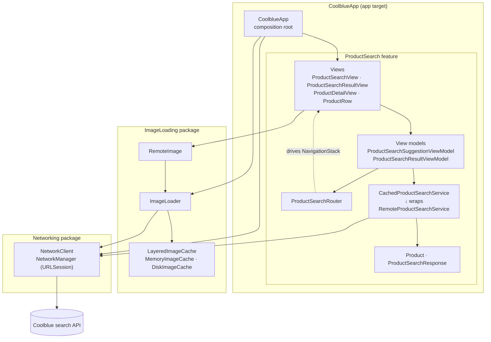

# CoolblueApp

A SwiftUI iPhone app for searching Coolblue's product catalogue. As you type, it suggests products; submitting a search opens a paginated result list, and tapping any product opens its details.

- **Search suggestions** appear after two characters, debounced by 300 ms, showing up to four products.
- **Search results** load page by page while you scroll, with empty, error and retry states.
- **Product details** show the image, rating, price, delivery and all USPs.
- **Images** are cached in memory and on disk; **search pages** are cached in memory for the session.
- **Localized** in English and Dutch with a String Catalog, including plurals.
- **Accessible**: each product row reads as one VoiceOver sentence.

Requires Xcode 26 and iOS 18.6 or later (iPhone, portrait).

## Running

Open `CoolblueApp.xcodeproj` and run the `CoolblueApp` scheme. The two local Swift packages under `Packages/` resolve automatically.

- **Unit tests** (`CoolblueAppTests`, Swift Testing): `⌘U`, or the `CoolblueAppTests` target in the Test navigator.
- **UI tests** (`CoolblueAppUITests`, XCTest) run against saved API responses, so they need no network.

## Architecture

The app is MVVM with a router, split into an app target and two local Swift packages:



Dependencies only point downwards: views know view models, view models know the service protocol and the router, and the packages know nothing about the app. `Networking` has no dependencies; `ImageLoading` depends on `Networking`.

### Search flow

```mermaid
sequenceDiagram
    actor User
    participant Search as ProductSearchView
    participant SVM as SuggestionViewModel
    participant Cache as CachedProductSearchService
    participant Remote as RemoteProductSearchService
    participant Router as ProductSearchRouter
    participant Results as ProductSearchResultView
    participant RVM as ResultViewModel

    User->>Search: types "ip"
    Search->>SVM: queryChanged("ip")
    Note over SVM: waits 300 ms; a newer keystroke cancels
    SVM->>Cache: search("ip", page 1)
    Cache->>Remote: not cached yet
    Remote-->>Cache: page 1
    Cache-->>SVM: page 1
    SVM-->>Search: first 4 products as suggestions

    User->>Search: taps "Search for "ip""
    Search->>SVM: submitSearch()
    SVM->>Router: showResults("ip")
    Router-->>Results: push results screen
    Results->>RVM: start()
    RVM->>Cache: search("ip", page 1)
    Cache-->>RVM: page 1 from memory, no request
    User->>Results: scrolls near the end
    RVM->>Cache: search("ip", page 2)
    User->>Results: taps a product
    RVM->>Router: showProduct(product)
    Router-->>User: product detail
```

## Main components

### App (`CoolblueApp/App`)

| Component | What it does |
|---|---|
| `CoolblueApp` | Composition root. Creates the one shared `NetworkClient` (15 s request timeout) and `ImageLoader` (memory + disk cache), injects the loader into the SwiftUI environment and shows `ProductSearchView`. |
| `LaunchEnvironmentNetworkClient` | Debug-only. When UI tests pass saved search pages in the launch environment, the app uses this client instead of the network. |

### ProductSearch feature (`CoolblueApp/ProductSearch`)

| Component | What it does |
|---|---|
| `Product`, `Promo`, `ProductSearchResponse` | Models decoded straight from the API. Decoding flattens the nested review summary, trims text and rounds prices to cents. |
| `ProductSearchEndpoint` | Builds the search URL, percent-encoding the query so `+`, `&` and `=` can't break parameters. |
| `ProductSearchService` / `RemoteProductSearchService` | The protocol the screens depend on, and its implementation: fetches a page through `NetworkClient`, maps `NetworkError` to `ProductSearchError`, and decodes off the main actor. |
| `CachedProductSearchService` | Wraps the remote service and keeps loaded pages in memory for the session, so the results screen reuses the page the suggestions already loaded. Failures aren't cached. |
| `ProductSearchError` | The errors screens can show, each with a user-facing (localized) message. |
| `ProductSearchRouter` | Owns the navigation path. `showResults` replaces the stack, so searching again never stacks results on results; `showProduct` pushes a detail screen. |
| `ProductSearchSuggestionViewModel` | Debounces typing, cancels outdated requests, shows up to four suggestions and submits the query to the router. Debounce, minimum length and count are injected through `ProductSearchSuggestionConfiguration`. |
| `ProductSearchResultViewModel` | Loads results page by page as rows near the end appear, de-duplicates products, stops at the last page and handles first-page and load-more errors separately. |
| `ProductSearchView` | Search field plus a suggestion list that stays on screen when navigating back. Hosts the `NavigationStack` and its destinations. |
| `ProductSearchResultView` | Result list with loading, empty, error and load-more footer states. |
| `ProductDetailView` | One product's full details. |
| `ProductRow` / `Product+Display` | A product row and the formatting it uses: currency, rating, highlighted USPs and the VoiceOver description. |

### Packages (`Packages/`)

| Package | Components |
|---|---|
| `Networking` | `NetworkClient` (the protocol everything depends on), `NetworkManager` (URLSession implementation; maps failures to a closed `NetworkError`). |
| `ImageLoading` | `ImageLoader` (an actor that shares concurrent downloads of the same URL and decodes off the main thread), `ImageCache` with `MemoryImageCache` (`NSCache`), `DiskImageCache` (Caches directory) and `LayeredImageCache` (memory first, then disk), and `RemoteImage`, a SwiftUI view that loads through the loader in the environment. |

## Localization

Strings live in `CoolblueApp/Localizable.xcstrings` (English source, Dutch translation). Review counts use plural variants (`1 review` / `952 reviews`, `1 beoordeling` / `952 beoordelingen`). Prices and ratings follow the user's locale through format styles. The packages have no user-facing text; a package that needs some later should receive its bundle and table name from the app.

## Testing

| Target | What it covers | Test data |
|---|---|---|
| Unit tests | Decoding, endpoint, error mapping, remote and cached services, both view models, router | Real API JSON (`Fixture.searchPage`) for decoding and the service; small id-based stubs (`Product.stub(id:)`) for view models, so each test shows its scenario and fails only for view-model reasons |
| UI tests | Launch, suggestions, results, paging, detail and back navigation, clearing the search | Two saved API pages passed to the app through the launch environment; the app runs in English with an `en_NL` locale |

## Further improvements

- **Offline handling**: an error-and-retry UI test, and checking the offline message on a device.
- **Tests**: `Product+Display` formatting with a fixed locale, and test targets for the `Networking` and `ImageLoading` packages.
